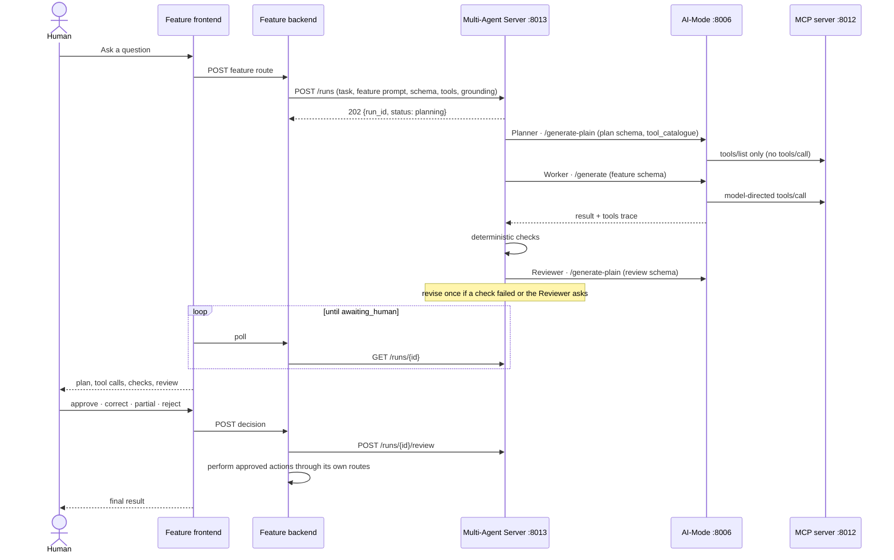

# Release 2 Multi-Agent Server contract

The shared Multi-Agent Server (`ai-services/multi-agent-server`, package
`multi_agent_service`) runs on the host at `http://127.0.0.1:8013`. Compose
backends reach it at `http://host.docker.internal:8013` with the existing
`host.docker.internal:host-gateway` mapping. It is never a Compose service.
Design rationale: [ADR 0005](./decisions/0005-shared-multi-agent-server.md).



## Endpoints

All JSON responses use `{"data": ...}`; errors use
`{"error": {"code", "message", "details": [{"field", "issue"}]}}`.

| Method | Path | Purpose | Success |
| --- | --- | --- | --- |
| `GET` | `/health` | Process status plus `store` and `ai_mode` dependencies, `active_runs`. Never fails. | `200` |
| `GET` | `/ready` | Ready only when the store works and AI-Mode reports `ok`. | `200` / `503` |
| `POST` | `/runs` | Start a workflow in the background. | `202` |
| `GET` | `/runs?feature=&status=&limit=` | Workflow history, newest first (`limit` 1–100). | `200` |
| `GET` | `/runs/{run_id}` | The run so far: plan, steps, checks, review, human decision. | `200` |
| `POST` | `/runs/{run_id}/review` | The human decision. | `200` |
| `GET` | `/runs/{run_id}/history` | Ordered coordination/audit events. | `200` |
| `GET` | `/runs/{run_id}/export?format=json\|markdown` | Run plus history as one evidence document. | `200` |

`run_id` matches `^magent_[0-9a-f]{12}$`.

## Starting a run: `POST /runs`

| Field | Type | Rules |
| --- | --- | --- |
| `feature` | string | One of `student-1` … `student-5` (`MULTI_AGENT_FEATURES`). |
| `task` | string | The traveller's request, 1–500 characters. |
| `trip_id` | string? | `trip_…` identifier, when the task is about a trip. |
| `context` | object | Feature data for the Worker, at most 4,000 characters as JSON. Its keys are sent at the top level of the Worker's message; `task`, `plan`, `allowed_tools`, `trip_id`, `first_tool`, `failed_checks` and `reviewer_feedback` are reserved. |
| `worker_system` | string | The feature's own Worker prompt, at most 6,000 characters. It leads the Worker's system prompt. |
| `output_schema` | JSON Schema | The Worker's result shape. Must be `type: object`, at most 6,000 characters, local `$ref`s only. |
| `allowed_tools` | string[] | MCP tool names the Worker may use (at most 24, distinct). Empty means no tool checks. |
| `grounding` | object? | `{source, id_paths, id_keys}`. Every value at an `id_path` (e.g. `suggestions[].transport_id`) must appear under an `id_key` (default `id`) in a successful tool result whose `source` matches. |
| `actions_path` | string? | Where the result lists changes for the human to approve, e.g. `actions`. |
| `correlation_id` | string? | `^[A-Za-z0-9][A-Za-z0-9._:-]{0,47}$`; stage calls append `.p1`, `.w1`, `.r1` … |
| `metadata` | object | Up to 6 string entries, values at most 160 characters. |

Unknown fields are rejected (`422 VALIDATION_ERROR`). At most
`MULTI_AGENT_MAX_ACTIVE_RUNS` (default 4) run at once; beyond that `POST /runs`
returns `503 RUN_LIMIT_REACHED`.

## The run record

```json
{
  "run_id": "magent_51c1747256fc",
  "feature": "student-3",
  "task": "What is the cheapest way to get from Melbourne to Sydney for two travellers?",
  "trip_id": null,
  "correlation_id": "student3-agents-live-mel",
  "status": "awaiting_human",
  "created_at": "2026-10-20T12:10:52Z",
  "updated_at": "2026-10-20T12:12:49Z",
  "attempts": 1,
  "plan": {"goal": "…", "steps": ["…"], "required_evidence": ["…"], "tools_to_use": ["transport_search"], "success_criteria": ["…"]},
  "steps": [
    {"agent": "planner", "attempt": 1, "status": "completed", "duration_ms": 43593, "ai_run_id": "aimode_…", "model": "llama3.1:8b", "output": {}, "tools": []},
    {"agent": "worker", "attempt": 1, "status": "completed", "duration_ms": 61944, "tools": [{"tool": "transport_search", "arguments": {}, "status": "success", "duration_ms": 0, "result": {}}]},
    {"agent": "reviewer", "attempt": 1, "status": "completed", "duration_ms": 11672, "output": {"verdict": "approve"}}
  ],
  "checks": [{"name": "grounding", "passed": true, "blocking": true, "detail": "all 1 referenced id(s) came from tool results"}],
  "review": {"verdict": "approve", "summary": "…", "issues": [], "risks": [], "recommendations": []},
  "result": {},
  "proposed_actions": [],
  "human": null,
  "final_result": null,
  "approved_actions": [],
  "error": null
}
```

`tools[]` is AI-Mode's trace shape, unchanged. After the human decision,
`human` holds `{decision, reviewer, notes, decided_at, accepted_actions}`,
`final_result` holds the result the human signed off (or `null` on reject),
and `approved_actions` the actions the feature backend should now perform.

## Statuses

| Status | Meaning |
| --- | --- |
| `planning` · `working` · `reviewing` | Agents are running. |
| `awaiting_human` | Agents are done; a decision is required. |
| `completed` | A human approved, corrected or partially accepted. |
| `rejected` | A human rejected; nothing is approved. |
| `failed` | A stage failed (`error.code`: `DEPENDENCY_UNAVAILABLE`, `DEPENDENCY_TIMEOUT`, `BAD_GATEWAY`, `PLANNER_INVALID_OUTPUT`, `REVIEWER_INVALID_OUTPUT`, `PROMPT_BUDGET_EXCEEDED`, `RUN_TIMEOUT`, `RUN_INTERRUPTED`, `INTERNAL_ERROR`). Completed steps, including partial tool traces, are kept. |

The Worker is retried once (`MULTI_AGENT_MAX_REVISIONS`, 0–2) when the
Reviewer returns `revise` or any deterministic check fails, with the
Reviewer's feedback and the failed checks in its message. After that the run
always goes to the human, whatever the verdict.

## Deterministic checks

| Check | Passes when |
| --- | --- |
| `output_schema` | The Worker returned JSON matching `output_schema`. |
| `allowed_tools` | Every tool call was in `allowed_tools` (only when the list is non-empty). |
| `tool_evidence` | At least one tool call succeeded (only when `allowed_tools` is non-empty). |
| `no_writes` | No called tool name contains `create`, `update`, `delete`, `remove`, `add` or `set`. |
| `grounding` | Every value at `grounding.id_paths` came from a successful tool result from `grounding.source`. |

All checks are blocking: a failure downgrades a Reviewer `approve` to `revise`.

## Human decision: `POST /runs/{run_id}/review`

| Field | Rules |
| --- | --- |
| `decision` | `approve`, `correct`, `partial` or `reject`. |
| `reviewer` | 1–60 characters; recorded as the audit actor `human:<reviewer>`. |
| `notes` | Optional, at most 1,000 characters. |
| `corrected_result` | Required for `correct`; validated against the run's `output_schema`. |
| `accepted_actions` | Required for `partial`; indexes into `proposed_actions`. |

Only a run in `awaiting_human` can be decided; otherwise `409
RUN_NOT_AWAITING_REVIEW`. An unknown run is `404 RUN_NOT_FOUND`.

## Audit events

Each event is `{sequence, run_id, at, actor, event, detail}`. Actors are `api`,
`planner`, `worker`, `reviewer`, `system` and `human:<name>`. Events in order:
`run_created`, `stage_started`/`stage_completed` per agent,
`checks_completed`, `review_completed`, `revision_requested`,
`awaiting_human`, `human_decision`, and one of `run_completed`,
`run_rejected` or `run_failed`. Details carry ids, statuses, counts and
durations, never prompts or tool data.

## Configuration

| Variable | Default |
| --- | --- |
| `MULTI_AGENT_HOST` / `MULTI_AGENT_PORT` | `127.0.0.1` / `8013` |
| `MULTI_AGENT_AI_MODE_URL` | `http://127.0.0.1:8006` |
| `MULTI_AGENT_MODEL` | unset (AI-Mode's default; must be on AI-Mode's allow-list) |
| `MULTI_AGENT_DB_PATH` | `ai-services/multi-agent-server/data/runs.sqlite3` |
| `MULTI_AGENT_FEATURES` | `student-1,…,student-5` |
| `MULTI_AGENT_PLANNER_TIMEOUT_SECONDS` / `_WORKER_` / `_REVIEWER_` | `90` / `200` / `60` |
| `MULTI_AGENT_RUN_TIMEOUT_SECONDS` | `420` (must cover one of each stage) |
| `MULTI_AGENT_MAX_REVISIONS` | `1` |
| `MULTI_AGENT_MAX_ACTIVE_RUNS` | `4` |
| `MULTI_AGENT_MAX_TASK_CHARS` | `500` |

Feature backends use `STUDENTn_BACKEND_MULTI_AGENT_{ENABLED,BASE_URL,TIMEOUT_SECONDS}`,
with `ENABLED=false` in CI and the cloud baseline. See the server README for
the integration kit.
