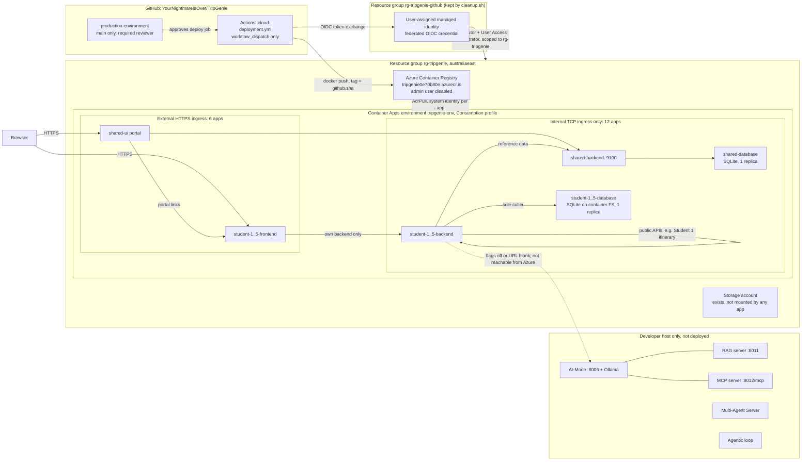
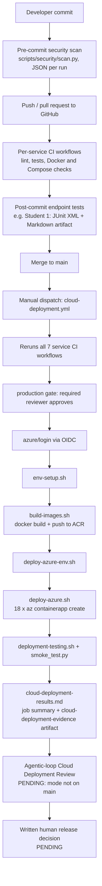

# TripGenie Release 2 Cloud Deployment Report

> **Status: DRAFT, not reviewed, release decision pending.** Refs #171.
> Group PDF due 25 Oct 2026, 11:59 PM AEST. This draft records what the
> repository and a read-only pre-rollout inspection on **21 Oct 2026** show.
> Anything without captured evidence is listed under
> [Pending evidence](#pending-evidence). It does not claim a successful
> `cloud-deployment.yml` run, a cloud review or a release approval.

## At a glance

| Item | State on 21 Oct 2026 |
| --- | --- |
| Deployment tooling | Merged in #179. Lab 11-style shell scripts, ACR and a Compose-to-Azure renderer. |
| Cloud-ready frontends and AI-off profile | Merged in #180 |
| Azure resources | 18 container apps show Running/Succeeded. Five have a failed latest revision (see [Limitations](#known-limitations)). |
| Public frontends | 6 of 6 returned HTTP 200 on first GET |
| `cloud-deployment.yml` run | **None yet** |
| Agentic-loop Cloud Deployment Review | **Not available.** The mode is not on `main`. |
| Final human release decision | **Pending** |

## Report narrative (for the group PDF)

TripGenie's Release 2 cloud baseline runs on Azure Container Apps in
`rg-tripgenie` (Australia East). It uses the Consumption workload profile of
the `tripgenie-env` environment. The deployment follows ASD Lab 11's scripts
rather than an infrastructure-as-code template. `compose_to_azure.py` renders
the 18 apps directly from `docker-compose.yml`. Each student gets a frontend,
backend and database, and the shared reference service gets three more apps.
Images go to a private Azure Container Registry with the admin user disabled.
Each app pulls its image with its own system-assigned identity and the AcrPull
role.

Six apps have public HTTPS ingress: the shared portal and five student
frontends. The other twelve, the backends and databases, have internal-only
TCP ingress on their Compose ports, so Compose service URLs work unchanged and
no database is reachable from the internet.

GitHub Actions signs in to Azure with OIDC through a user-assigned managed
identity. The repository stores only identifiers, not a password. The
`cloud-deployment.yml` workflow runs every service's CI first. A `production`
environment gate, limited to `main` with a required reviewer, then guards the
deploy job. That job builds images tagged with the commit SHA, deploys them and
runs a smoke test.

AI-Mode, MCP, RAG, the Multi-Agent Server and the agentic loop run on the
developer host only. The cloud profile turns their feature flags off.

There are three known trade-offs. Each database is a single replica that stores
SQLite on the container filesystem, so a restart or redeploy restores the seed
data. Frontends scale to zero by default and can cold-start. Some student
frontends still build `http://` asset and form URLs behind Azure's HTTPS proxy.

The 21 Oct inspection found every public frontend serving HTTP 200. However,
five apps had a failed latest revision while an older working revision
continued to serve. A fix is in progress, and a reviewed workflow run is still
required before the release decision.

*(About 310 words. Update the last paragraph once the pending evidence
exists.)*

## Azure reference architecture

Unlike the original #171 task list, the deployed system uses **ACR, not GHCR**.
It has **no Azure Files mount**: the storage account is unused and the
environment storage list is empty. The scripts do not configure a Log
Analytics workspace, and none was checked. Bicep is not used. The header of
`shared/configuration/.env.cloud` still mentions Bicep parameters, but that
comment is stale.

## DevOps flow

The smoke test checks that each public frontend returns HTTP 200. It runs a
Student 1 trip create, read, delete and verify-gone cycle through the cloud
frontend, and it expects HTTP 503 from Student 1's RAG panel. It does not cover
CRUD for Students 2 to 5.

## AI-off configuration

| Mechanism | Scope | Evidence status |
| --- | --- | --- |
| `*_RAG_ENABLED=false` and `*_MCP_ENABLED=false`, plus `STUDENT4_AI_ASSISTANT_ENABLED=false` | RAG and MCP panels for Students 1, 3, 4 and 5 | Configured in `.env.cloud` (#180) |
| Blank `STUDENT2_BACKEND_AI_MODE_URL` and `STUDENT2_BACKEND_RAG_URL` | Student 2 ask and guide panels | Configured. The renderer drops blank values. |
| No flag: direct AI-Mode calls | Student 1 AI suggestions, Student 3 AI transport suggestions, Student 5 AI budget analysis | Code returns "AI-Mode unavailable". **Not live-tested in Azure.** |
| Not deployed | AI-Mode, MCP, RAG, Multi-Agent Server, agentic loop, Ollama | Absent from the 18-app list |

## Ownership

| Area | Owner |
| --- | --- |
| This report, architecture and release decision (#171) | Student 1 (`aadirai31`) |
| Required reviewer on the `production` environment | `aadirai31` |
| Deployment scripts, workflow and cloud profile (#179, #180) | Student 1, merged |
| Agentic-loop Cloud Deployment Review mode | The teammate who owns the shared agentic loop. Not yet on `main`. |
| Cloud CRUD evidence for each feature | Each student for their own slice |

## Evidence index

| Evidence | Location | Status |
| --- | --- | --- |
| Deployment guide and differences from Lab 11 | [`scripts/deploy/azure/README.md`](../../../scripts/deploy/azure/README.md) | Available |
| Cloud workflow | [`.github/workflows/cloud-deployment.yml`](../../../.github/workflows/cloud-deployment.yml) | Available. Never run. |
| App renderer, smoke test and validation script | [`compose_to_azure.py`](../../../scripts/deploy/azure/compose_to_azure.py), [`smoke_test.py`](../../../scripts/deploy/azure/smoke_test.py), [`deployment-testing.sh`](../../../scripts/deploy/azure/deployment-testing.sh) | Available |
| AI-off profile | [`shared/configuration/.env.cloud`](../../../shared/configuration/.env.cloud) | Available |
| Script-driven Azure deployment | [PR #179](https://github.com/YourNightmareIsOver/TripGenie/pull/179) | Reported in the PR. No committed log. |
| Student 1 post-commit endpoint tests | [Run 39569785539](https://github.com/YourNightmareIsOver/TripGenie/actions/runs/39569785539), artifact `student-1-endpoint-test-evidence`: 7 passed, 0 failed, 0 errors, 0 skipped. [Report](student-1-post-commit-testing-report.md) | Available |
| Student 1 pre-commit security scan | [Report](student-1-pre-commit-security-report.md) (#182) | Historical scan evidence. It does not prove that every commit on every machine was scanned. |
| Live resource state | Read-only inspection, 21 Oct 2026 (this report) | Observation only. No exported log is committed. |

## Known limitations

- **Ephemeral data.** Each database runs exactly one replica and stores SQLite
  on the container filesystem. A restart or redeploy resets it to the seed
  data. No Azure Files share is mounted.
- **Cold starts.** Frontends scale to zero unless the workflow runs with
  `frontend_min_replicas=1`. The internal apps keep one replica.
- **HTTP URLs behind the HTTPS proxy.** Student frontends still emit
  `http://` asset, form and HTMX URLs derived from `request.url_for`. This
  risks mixed-content blocking or redirects. The fix is in progress on branch
  `aadirai31/cloud-deployment-prerequisites`. It is not merged or deployed.
- **Failed latest revisions.** On 21 Oct 2026, five apps had a failed or
  unhealthy latest revision running Microsoft's quickstart placeholder image:
  `shared-database`, `student-1-frontend`, `student-3-frontend`,
  `student-4-backend` and `student-4-frontend`. Older revisions with the real
  application were still serving. This deployment is not a clean final
  release.
- **Image tags.** The current images are tagged `latest` by the earlier
  script-driven deploy. The workflow tags images with `github.sha`, but no
  workflow run has produced SHA-tagged images yet.
- **Cost.** No cost was observed. The README's estimate of about US$2 a day is
  not a measurement.
- **Observability.** No Log Analytics workspace is configured or evidenced.

## Final human release decision

**PENDING. Not approved.** A `production` environment gate exists, but the gate
is only a control. An approval click is not a recorded decision. The decision
will be written here as approve, partially accept or reject, with reasons. It
will link to the workflow run, its `production` approval and the review output.
It can only be recorded after the pending evidence below exists.

## Pending evidence

1. A successful `cloud-deployment.yml` run, with its link, log and
   `cloud-deployment-evidence` artifact. This depends on the prerequisite fixes
   landing first.
2. A clean revision state for all 18 apps, including the five listed above.
3. Screenshots of each of the six public frontends at their Azure URLs.
4. CRUD evidence in the cloud for every feature. The smoke test covers only
   Student 1.
5. Live proof that the AI features are off, including the three direct
   AI-Mode panels that have no flag.
6. Agentic-loop Cloud Deployment Review output and its validation log. This is
   blocked until the shared mode exists.
7. The written human release decision, with the `production` approval link.
8. The observed cost, if it will be reported.
9. The cloud segment of the showcase video.
