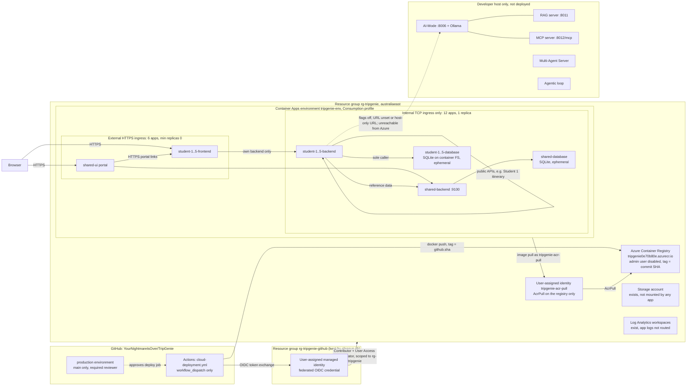

# TripGenie Release 2 Cloud Deployment Report

> **Status: DRAFT. Not reviewed, and the release decision is pending.**
> Refs #171. The group PDF is due 25 Oct 2026, 11:59 PM AEST.
>
> This report covers the first `cloud-deployment.yml` run, made on 21 Oct
> 2026, and the checks that followed it. It does not claim an agentic-loop
> review, a final release decision or the showcase video. Those are listed
> under [Pending evidence](#pending-evidence).

## At a glance

| Item | State (21 Oct 2026) |
| --- | --- |
| Deployment tooling | Lab 11-style shell scripts, ACR and a Compose-to-Azure renderer (#179). Cloud-ready frontends and the AI-off profile came in #180. Prerequisite fixes came in #187. |
| Cloud Deployment workflow | [Run 39580927565](https://github.com/YourNightmareIsOver/TripGenie/actions/runs/39580927565) **succeeded on its first attempt** at 10:07:58Z (21:07:58 AEDT), building `main` at `188951a` |
| Azure resources | 18 apps run the full-SHA image. Each latest revision is Healthy and serves 100% of traffic. [Details](cloud-evidence/run-39580927565-summary.md) |
| Public frontends | 6 of 6 return HTTP 200 over HTTPS. [Screenshots](cloud-evidence/live-checks-2026-10-21.md#screenshots-of-the-six-public-frontends) |
| Cloud CRUD | Student 1 is checked by the workflow. Students 2–5 were checked manually with disposable records ([evidence](cloud-evidence/live-checks-2026-10-21.md#students-25-crud-through-the-cloud-frontends)). |
| AI off | No AI services are deployed. RAG, MCP and the assistant are switched off by flags. Three direct AI-Mode paths are unreachable but not disabled ([details](#ai-off-configuration)). |
| Observed cost | AUD 5.91 for 19–21 Oct, with 21 Oct only partly billed ([details](cloud-evidence/cost-2026-10-21.md)) |
| Agentic-loop Cloud Deployment Review | **Not available.** The mode is not on `main`. |
| Final human release decision | **Pending** |

## Report narrative (for the group PDF)

TripGenie's Release 2 cloud baseline runs on Azure Container Apps in
`rg-tripgenie` (Australia East). It uses the Consumption profile of the
`tripgenie-env` environment. The deployment follows ASD Lab 11's shell scripts
rather than an infrastructure-as-code template. `compose_to_azure.py` renders
the 18 apps directly from `docker-compose.yml`: a frontend, backend and
database for each of the five students, plus the shared reference service.
Images are tagged with the commit SHA and pushed to a private Azure Container
Registry with the admin user disabled. Every app pulls through one
registry-scoped AcrPull identity, `tripgenie-acr-pull`.

Six apps have public HTTPS ingress: the portal and five student frontends.
The twelve backends and databases accept only internal TCP on their Compose
ports, so no database is reachable from the internet.

GitHub Actions signs in to Azure with OIDC through a managed identity, so the
repository stores identifiers, not passwords. `cloud-deployment.yml` first
reruns every service's CI. A `production` environment gate then guards the
deploy job, which builds, pushes and deploys the images. The job waits until
each app's latest revision is ready with the requested image, and then runs a
smoke test.

AI-Mode, MCP, RAG, the Multi-Agent Server and the agentic loop run only on the
developer host. The cloud profile switches off RAG, MCP and the Student 4
assistant. Three direct AI-Mode paths have no flag. They point at a
host-only address, so they are unreachable in Azure.

A pre-rollout inspection on 21 Oct found five apps whose latest revision had
failed on a placeholder image. A first-attempt workflow run then deployed
commit `188951a` and fixed this. All 18 latest revisions are now healthy,
every frontend returns HTTP 200, and CRUD worked for all five features with
disposable records.

There are three trade-offs. Each database is a single SQLite replica on the
container filesystem, so data resets to the seed on every new revision.
Frontends scale to zero and cold-start. App logs are not routed to Log
Analytics.

The agentic-loop review and the human release decision are still pending.

*(About 360 words. Update the last paragraph once the review and the decision
exist.)*

## Azure reference architecture

**Identity.** Since #187, all 18 apps pull images through the user-assigned
`tripgenie-acr-pull` identity, which holds AcrPull on the registry only. The
earlier per-app system-assigned identities have been removed. Their AcrPull
role assignments are orphaned and remain until an optional cleanup. The
deployment identity keeps User Access Administrator, scoped to `rg-tripgenie`,
so it can grant that pull role.

**Differences from the original #171 task list.** The deployed system uses
**ACR, not GHCR**, and shell scripts, **not Bicep**. There is **no Azure Files
mount**: the storage account is unused and the environment storage list is
empty. Two Log Analytics workspaces exist in the group, but the environment
has no app-log destination. A header comment in
`shared/configuration/.env.cloud` still mentions Bicep parameters, and that
comment is stale.

## DevOps flow

```mermaid
flowchart TD
  dev["Developer commit"] --> pre["Pre-commit security scan<br/>scripts/security/scan.py, JSON per run"]
  pre --> push["Push / pull request to GitHub"]
  push --> ci["Per-service CI workflows<br/>lint, tests, Docker and Compose checks"]
  ci --> ept["Post-commit endpoint tests<br/>e.g. Student 1: JUnit XML + Markdown artifact"]
  ept --> merge["Merge to main"]
  merge --> dispatch["Manual dispatch: cloud-deployment.yml"]
  dispatch --> reuse["Reruns all 7 service CI workflows"]
  reuse --> approve["production gate: required reviewer approves"]
  approve --> login["azure/login via OIDC"]
  login --> s1["env-setup.sh"]
  s1 --> s2["build-images.sh<br/>docker build + push to ACR, tag = commit SHA"]
  s2 --> s3["deploy-azure-env.sh"]
  s3 --> s4["deploy-azure.sh<br/>18 apps, pull via tripgenie-acr-pull"]
  s4 --> gate2["Revision gate: latest revision ready<br/>with the requested image"]
  gate2 --> s5["deployment-testing.sh + smoke_test.py"]
  s5 --> art["cloud-deployment-results.md<br/>job summary + cloud-deployment-evidence artifact"]
  art --> review["Agentic-loop Cloud Deployment Review<br/>PENDING: mode not on main"]
  review --> decision["Written human release decision<br/>PENDING"]
```

Run [39580927565](https://github.com/YourNightmareIsOver/TripGenie/actions/runs/39580927565)
completed every step up to and including the artifact. Its step timings,
revision lines and artifacts are in the
[run summary](cloud-evidence/run-39580927565-summary.md). The smoke test
covers six frontend GETs, the Student 1 trip create, read, delete and
verify-gone cycle, and a 503 from Student 1's RAG panel. It does not cover
CRUD for Students 2–5, which was checked separately (see the
[evidence index](#evidence-index)).

## AI-off configuration

The full table of deployed settings is in
[`ai-off-2026-10-21.md`](cloud-evidence/ai-off-2026-10-21.md). In summary:

| State | Scope | Evidence |
| --- | --- | --- |
| Not deployed | AI-Mode, Ollama, MCP server, RAG server, Multi-Agent Server, agentic loop | Absent from the 18-app list |
| Disabled by flag | RAG and MCP for Students 1, 3, 4 and 5; Student 4 assistant (`AI_ASSISTANT_ENABLED=false`) | Deployed settings read 21 Oct. Student 1 RAG returned **503 live** in the run. The others were not live-tested. |
| Disabled because no URL is set | Student 2 AI-assisted search and RAG (`AI_MODE_URL` and `RAG_URL` absent) | Deployed settings read 21 Oct. Not live-tested. |
| **Unreachable, not disabled** | Student 1 AI suggestions, Student 3 AI transport suggestions, Student 5 AI budget analysis | Each AI-Mode URL is `http://host.docker.internal:8006`, which does not exist in Azure. Student 1's backend would treat a *blank* URL as disabled, but the deployed URL is not blank. These paths were not called live. [PR #190](https://github.com/YourNightmareIsOver/TripGenie/pull/190) would blank Student 1's URL in the cloud and drive AI UI visibility from `/api/ai-features`. That PR is **open, not merged or deployed**, and it is not part of `188951a`. |
| Still visible in the UI | AI, RAG and MCP controls on the Student 2–5 pages | Shown in the [screenshots](cloud-evidence/live-checks-2026-10-21.md). Hiding them is not deployed. |

## Ownership

| Area | Owner |
| --- | --- |
| This report, architecture and release decision (#171) | Student 1 (`aadirai31`) |
| Required reviewer on the `production` environment | `aadirai31` |
| Deployment scripts, workflow, cloud profile and prerequisite fixes (#179, #180, #187) | Student 1, merged |
| Agentic-loop Cloud Deployment Review mode | The teammate who owns the shared agentic loop. Not yet on `main`. |
| Cloud CRUD for each feature | Each student for their own slice. Point-in-time checks are recorded here. |

## Evidence index

| Evidence | Location | Status |
| --- | --- | --- |
| Deployment guide, identity, revision gate and HTTPS settings | [`scripts/deploy/azure/README.md`](../../../scripts/deploy/azure/README.md) | Available |
| Cloud workflow | [`.github/workflows/cloud-deployment.yml`](../../../.github/workflows/cloud-deployment.yml) | Available |
| Renderer, smoke test and validation script | [`compose_to_azure.py`](../../../scripts/deploy/azure/compose_to_azure.py), [`smoke_test.py`](../../../scripts/deploy/azure/smoke_test.py), [`deployment-testing.sh`](../../../scripts/deploy/azure/deployment-testing.sh) | Available |
| AI-off profile | [`shared/configuration/.env.cloud`](../../../shared/configuration/.env.cloud) | Available |
| Prerequisite fixes | [PR #187](https://github.com/YourNightmareIsOver/TripGenie/pull/187), merged as `188951a` | Merged and deployed by the run below |
| Successful cloud workflow run | [Run 39580927565](https://github.com/YourNightmareIsOver/TripGenie/actions/runs/39580927565). See the [summary](cloud-evidence/run-39580927565-summary.md) for steps, revision gate and live state. | Available. The artifacts are kept until 2027-01-19. |
| Validation results artifact | [`run-39580927565-cloud-deployment-results.md`](cloud-evidence/run-39580927565-cloud-deployment-results.md) (verbatim) | Available |
| `production` approval | Recorded on the run: approved by `aadirai31` for this deployment | **Operational only, not the release decision** |
| Student 1 post-commit endpoint tests | Run 39580927565 artifact `student-1-endpoint-test-evidence`: 7 of 7 pass. Earlier run [39569785539](https://github.com/YourNightmareIsOver/TripGenie/actions/runs/39569785539). [Report](student-1-post-commit-testing-report.md) | Available |
| Student 1 pre-commit security scan | [Report](student-1-pre-commit-security-report.md) (#182) | Historical scan evidence. It does not prove that every commit on every machine was scanned. |
| Frontend screenshots | [Live checks](cloud-evidence/live-checks-2026-10-21.md#screenshots-of-the-six-public-frontends), [`screenshots/`](cloud-evidence/screenshots/) | Captured 11:12Z, 21 Oct |
| Students 2–5 cloud CRUD | [Live checks](cloud-evidence/live-checks-2026-10-21.md#students-25-crud-through-the-cloud-frontends) | 28 of 28 checks passed with disposable records. Manual, not CI. |
| AI-off settings | [`ai-off-2026-10-21.md`](cloud-evidence/ai-off-2026-10-21.md) | Available, with stated gaps |
| Observed cost | [`cost-2026-10-21.md`](cloud-evidence/cost-2026-10-21.md) | Partial: billing lags |
| Pre-rollout inspection | Read-only, 21 Oct 2026, summarised under [Known limitations](#known-limitations) | Historical observation |

## Known limitations

- **Ephemeral data.** Each database runs one replica and stores SQLite on the
  container filesystem. A restart or new revision resets it to the seed data,
  as happened for run 39580927565. No Azure Files share is mounted.
- **Cold starts.** Frontends scale to zero unless the workflow runs with
  `frontend_min_replicas=1`. The first portal load on 21 Oct took 17.6 s. The
  internal apps keep one replica.
- **Direct AI paths are unreachable rather than disabled** (see
  [AI-off configuration](#ai-off-configuration)). For Student 1,
  [PR #190](https://github.com/YourNightmareIsOver/TripGenie/pull/190) would
  blank the cloud URL and hide the AI controls. It is open but not merged or
  deployed. Taking effect would need both the merge and a newly authorised
  deployment. Students 3 and 5 have no equivalent change.
- **Observability.** Two Log Analytics workspaces exist, but the environment
  sends no app logs to them. Evidence comes from workflow logs and artifacts.
- **Leftover role assignments.** The AcrPull grants for the removed system
  identities are orphaned. Removing them is optional cleanup and has not been
  done.
- **Cloud CRUD automation.** Only Student 1 CRUD runs in the workflow.
  Students 2–5 have point-in-time manual evidence only. Student 5 expenses
  and Student 4 itinerary links were not tested.
- **Cost.** The observed AUD 5.91 is partial, because billing lags usage and
  the 21 Oct row is incomplete. It is not a monthly projection.
- **Resolved: placeholder revisions and HTTP links.** The 21 Oct pre-rollout
  inspection found five apps (`shared-database`, `student-1-frontend`,
  `student-3-frontend`, `student-4-backend` and `student-4-frontend`) whose
  latest revision had failed on Microsoft's quickstart image. Older revisions
  were still serving. At the same time, the student frontends emitted
  `http://` asset and form URLs behind Azure's HTTPS proxy.
  - **Cause.** With Azure CLI 2.91.0, `az containerapp create
    --registry-identity system` first stages the quickstart image. In the
    earlier laptop deployments, the second update that restores the real
    image never ran.
  - **Fix.** [PR #187](https://github.com/YourNightmareIsOver/TripGenie/pull/187)
    added the registry-only `tripgenie-acr-pull` identity and the revision
    readiness gate. It also sets `FORWARDED_ALLOW_IPS` from the cloud-only
    `TRIPGENIE_FORWARDED_ALLOW_IPS=*`; locally, only loopback is trusted.
  - **Deployed.** Run 39580927565 deployed the fix. Every latest revision is
    now healthy with the SHA image, and the generated links are HTTPS only.

## Final human release decision

**PENDING. Not approved.**

The `production` approval on run 39580927565 authorised that operational
deployment. It is not a release decision. The decision will be written here as
approve, partially accept or reject, with reasons. It will link to the
workflow run and the review output, and it can only be recorded after the
review below exists.

## Pending evidence

1. **Agentic-loop Cloud Deployment Review output and its validation log.**
   Blocked: `agentic_loop.py` on `main` offers only the `services`, `mcp`,
   `rag` and `ci` modes. When the review exists, record it in the artifact's
   "Reviewer Notes".
2. **The written human release decision**, linked to the run and the review.
3. **The cloud segment of the showcase video.**
4. **Optional improvements:**
   - automated CRUD for Students 2–5 in the cloud smoke test;
   - live proof that the three direct AI-Mode paths report "unavailable", or
     disabling them by configuration (for Student 1, merge and deploy
     [PR #190](https://github.com/YourNightmareIsOver/TripGenie/pull/190));
   - a later cost query once billing settles.
