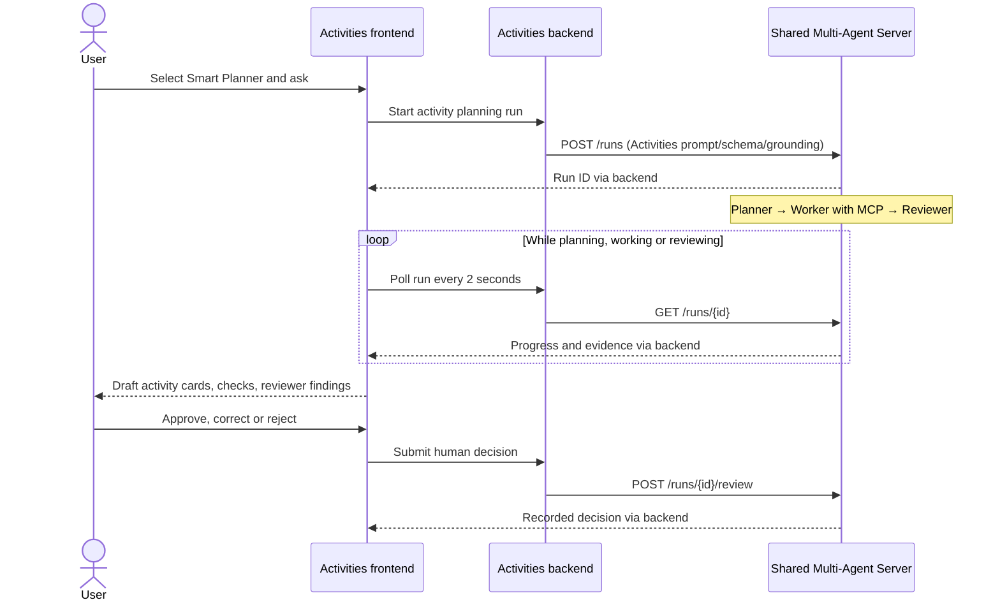

← Back to [README.md](../../README.md)

# Activities and Attractions Frontend Service

## Service scope

This service renders Student 4's traveller catalogue and management interface. It
talks only to the [Student 4 backend](./backend-service-api.md), never to the
database or shared reference services.

```text
              browser
                 |  :8084 host / container  HTML
                 v
       student-4-frontend -- Jinja templates + HTMX
                 |  :8008  activity and itinerary-proxy routes
                 v
        student-4-backend
```

The backend returns JSON, while HTMX swaps HTML fragments. The frontend service
therefore owns presentation and translates browser-friendly `GET` parameters
into the backend's structured `QUERY /activity` body. It does not duplicate
database filtering logic.

The page covers both activities and attractions because both are represented
by the single `Activity` model. It intentionally contains no image UI and no
booking or payment workflow.

## Configuration

| Variable | Default | Purpose |
|---|---|---|
| `BACKEND_URL` | `http://student-4-backend:8008` | Student 4 backend-service base URL. |
| `BACKEND_TIMEOUT` | `5` | Backend request timeout in seconds. |
| `AI_TIMEOUT` | `210` | Timeout for each AI planning or evaluation request only. |

Run the frontend with:

```bash
docker compose up student-4-frontend
```

Then open `http://localhost:8084`. Start the complete Student 4 slice with
`docker compose up --build --remove-orphans student-4`. The orphan cleanup
removes the retired `student-4-service` directory-server container if it exists,
freeing the assignment port for the real frontend.

## HTML routes

These routes return pages or fragments, not a public JSON API.

| Route | Returns |
|---|---|
| `GET /` | Unified catalogue and CRUD page, including inactive entries. |
| `GET /activity` | Results-and-pagination HTML fragment. |
| `GET /activity/{id}` | Full activity-detail dialog fragment. |
| `GET /activity/{id}/itineraries/dialog` | Direct trip-picker dialog fragment. |
| `GET /activity/{id}/itineraries` | Itinerary picker fragment from the Student 4 proxy. |
| `PUT /activity/{id}/itineraries/{trip_id}` | Add or reschedule an itinerary selection. |
| `DELETE /activity/{id}/itineraries/{trip_id}` | Remove an itinerary selection. |
| `GET /manage` | Legacy catalogue management page. |
| `GET /manage/activity/new` | Create-activity form fragment. |
| `POST /manage/activity` | Create a complete activity aggregate. |
| `GET /manage/activity/{id}/edit` | Prefilled edit form fragment. |
| `PUT /manage/activity/{id}` | Replace a complete activity aggregate. |
| `GET /manage/activity/{id}/delete` | Permanent-delete confirmation fragment. |
| `DELETE /manage/activity/{id}` | Permanently delete an activity aggregate. |
| `GET /health` | Frontend and backend health JSON. |
| `GET /ready` | Readiness JSON; returns `503` until the backend is ready. |
| `POST /suggestions/ask` | Submit a question to the shared MCP assistant (`mode=tools`, default, with optional trip) or to the RAG activity guides (`mode=knowledge`). |

`GET /health` returns `200` with `status: "degraded"` when the backend cannot be
reached, matching the other frontend services.

`GET /ready` returns `503` until the public backend reports that its required
database dependency is ready. Docker Compose uses this endpoint to gate the
Student 4 grouping target.

## Page structure

The traveller page has four regions:

1. A heading explaining that attractions and activities share one catalogue.
2. One search-and-filter form.
3. An `aria-live` results region containing create and per-card edit controls,
   cards, count and pager.
4. A dialog target populated when a user opens an activity.

The catalogue includes inactive entries and provides creation, replacement,
deactivation and deletion without requiring a separate management page.

## MCP activity assistant

The primary AI panel submits a question and optional trip through
`POST /suggestions/ask` to backend `/activity/assistant`. Each request is independent.
Shared AI-Mode performs model-directed MCP calls; the frontend renders escaped
model text and authoritative activity cards resolved by its own backend.

**Tools used** shows names, arguments, status, timings, errors and expandable actual
returned MCP data, including other domains. Failed runs retain completed calls.
The assistant can execute requested actions through advertised write tools; the UI
therefore does not promise that nothing has been saved. Ordinary activity and
itinerary actions remain available. Loading state and full-page form fallback are
preserved. See [setup](mcp-assistant.md).

## RAG activity guides

The same panel offers an **Activity guides (RAG)** mode. With `mode=knowledge`,
`POST /suggestions/ask` sends only the question to backend `/activity/knowledge`
and renders `partials/knowledge_results.html`: a confidence badge, the escaped
grounded answer, and a numbered **Sources** list with each citation's title,
section, repository path and excerpt, plus request, RAG run and retrieval
details. Insufficient context, disabled RAG and failures render explicit
banners without sources, and state that browsing remains available. The trip
picker is ignored in this mode. See [RAG knowledge](rag-knowledge.md).

## Smart Planner

The existing AI activity assistant has a third radio option, **Smart Planner**,
using the same question box and optional trip selector. Activity tools (MCP) and
Activity guides (RAG) remain separate modes.

The activity MCP and Smart Planner prompts treat each submission as a one-shot
request. They must not ask follow-up questions or expect human review to supply
missing inputs. Human review accepts or corrects the finished draft, or rejects it with feedback to request a new run.
Unspecified inputs are identified in the response, using catalogue evidence for
the known constraints; an unknown party size must not produce a verified total-budget
recommendation.

The new flow is:



`/planner/{run_id}` is a bookmarkable full page and an HTMX partial endpoint.
Active runs poll; awaiting-human and terminal states stop polling. Refresh links
work without JavaScript. Errors stop automatic polling and provide a refresh
link for known runs. Failed review submissions preserve the entered reviewer,
notes, correction text parts, trip, optional per-activity date/time and card selections in both HTMX and full-page
responses. The frontend safely reads current run status after a failure; it never
retries the decision. If status is unavailable or no longer awaiting review, the
submitted form remains editable with decision controls disabled. **Refresh status
and keep edits** posts the fields to `/planner/{run_id}/recover`, which only reads
the backend run and repopulates the form; it never submits a review decision.
The preserved form is request-local, not durable draft storage: navigating away
or opening a fresh run URL discards unsaved edits. A start timeout has no
guaranteed run ID: do not assume the server did not start work or automatically
resubmit it.

The results show the plan, tool calls/results, stage attempts, validation checks,
reviewer findings and human decision. Model text is escaped. Draft cards do not
show the independent Add to itinerary action. Each draft card has a **Dismiss
suggestion** button. Dismissal posts only presentation state to
`/planner/{run_id}/selection`, reads the current run and hides that card without
changing agent evidence. **Restore all suggestions** reverses dismissals. These
controls retain typed reviewer, notes, correction, trip and schedule fields.
Selected IDs are validated against the backend-grounded activity cards. The
selected subset is also represented in the run URL for refreshes. If cards are
dismissed, the original narrative is hidden because it may describe removed
suggestions; its original text remains in the correction fields and evidence.

**Approve and add to trip** submits the explicitly selected cards, a trip and
optional per-card local date/time to the backend's existing itinerary integration.
Text-only results can be approved without itinerary writes. Individual additions
show added/already-present outcomes and any errors. Approval and additions are
not replayed after a lost response: **Refresh status and keep edits** reads only
the run. A completed run confirms that approval was recorded; users check their
trip when the original addition response is unavailable. Accepted cards retain
the ordinary manual itinerary control for subsequent changes.

Correction edits recommendation text and selects which grounded cards to keep;
it does not rerun an agent. Saving retained cards uses the same trip integration.
Each original text part gets its own textarea (up to 1000 characters). Clearing a
text part removes it; at least one nonempty text part is required. Corrected
output retains the limits of twelve total parts and six cards. A text-only
correction records no itinerary additions. Failed blocking checks disable
approval and correction; rejection remains available.

**Reject** records rejection without another search. **Reject and regenerate**
requires the reviewer name and a nonempty explanation (at most 1000 characters).
It posts to `/planner/{run_id}/regenerate`; the backend records rejection and
starts a new run using the original question/trip and feedback, including the
explicitly dismissed IDs. The new result links to the previous rejected run.
A failed response preserves feedback and reads the original run; regeneration
is never automatically repeated.

`/planner/{run_id}/history` downloads JSON evidence through the backend. History
includes the run, stage outputs/tool traces and coordination/audit events. It is
not published automatically. Reviewer names are user-entered audit labels, not
verified identities. No per-user authentication is introduced by this feature.

Local and cloud-disabled states remain understandable without breaking catalogue
browsing. Smart Planner is enabled by default locally and explicitly disabled in
CI and the cloud profile. See the backend API documentation for configuration and the
shared service's retrospective tool-check contract.
